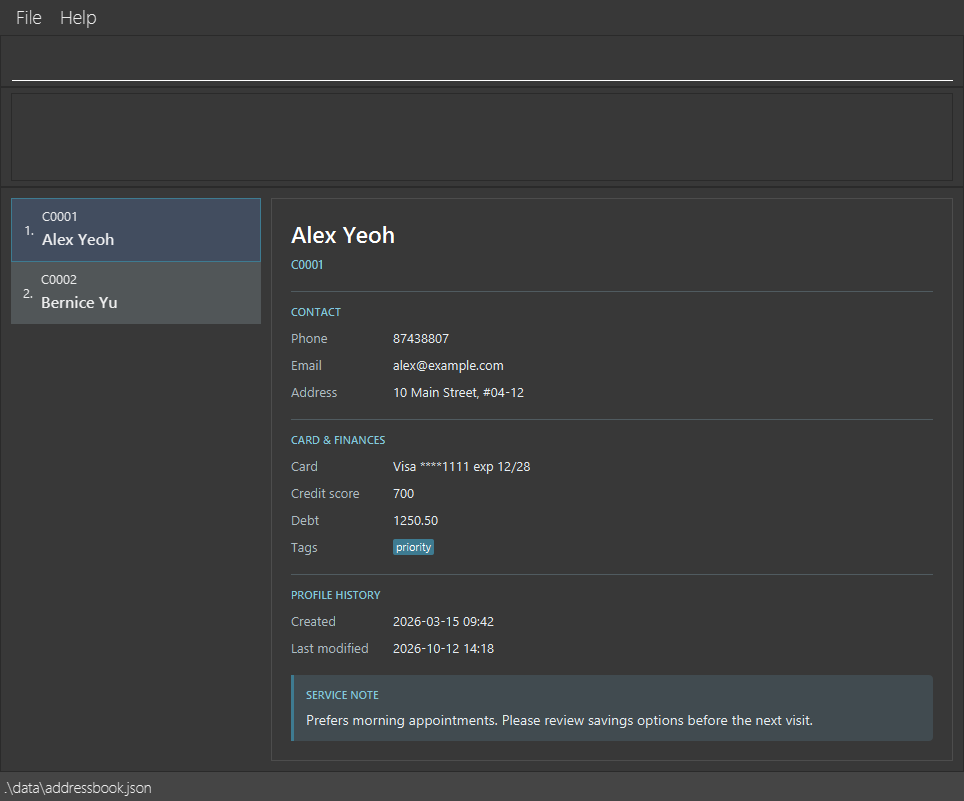

# TellerFlow User Guide

TellerFlow is a **desktop application for managing client profiles, optimized for use through a Command Line Interface (CLI)** while retaining the benefits of a Graphical User Interface (GUI). If you type quickly, TellerFlow can help you manage client contact details, card information, finances, and service notes efficiently.

<!-- * Table of Contents -->
<page-nav-print />

--------------------------------------------------------------------------------------------------------------------

## Quick start

1. Ensure that Java `25` or later is installed on your computer.<br>
   **Mac users:** Ensure you have the precise JDK version prescribed [here](https://se-education.org/guides/tutorials/javaInstallationMac.html).

1. Download the latest `addressbook.jar` file from the [TellerFlow releases page](https://github.com/AY2627S1-CS2103T-F08-4/tp/releases).

1. Copy the file to the folder you want to use as the _home folder_ for TellerFlow.

1. Open a terminal, `cd` to the folder containing the JAR file, and run `java -jar addressbook.jar`.<br>
   A GUI similar to the one below should appear in a few seconds. On a first run, the client list shows sample clients.<br>
   

1. Type a command in the command box and press Enter to execute it. For example, type **`help`** and press Enter to open the help window.<br>
   Click a client in the list to see their details, timestamps, and service note in the pane beside it.
   Some example commands you can try:

   * `list` : Lists all clients.

   * `add r/C0001 n/John Doe` : Adds a client named `John Doe` with a reference and name. Other details can be filled in later.

   * `delete 3` : Deletes the 3rd client shown in the current list.

   * `note r/C0001 s/Prefers morning appointments` : Adds or replaces that client's service note.

   * `sort` or `sort asc` : Sorts the displayed clients by name from A to Z. Use `sort desc` for Z to A, or `sort reset` to restore the original stored order.

   * `clear` : Deletes all clients.

   * `exit` : Exits the app.

1. Refer to the [Features](#features) section below for details of each command.

--------------------------------------------------------------------------------------------------------------------

## Features

<box type="info" seamless>

**Notes about the command format:**<br>

* Words in `UPPER_CASE` are the parameters to be supplied by the user.<br>
  For example, in `add r/REFERENCE n/NAME`, replace `REFERENCE` with `C0001` and `NAME` with `John Doe`.

* Items in square brackets are optional.<br>
  For example, `n/NAME [t/TAG]` can be used as `n/John Doe t/friend` or as `n/John Doe`.

* Items followed by `...` can appear zero or more times.<br>
  For example, `[t/TAG]... ` may be omitted, or written as `t/friend` or `t/friend t/family`.

* Prefixed parameters can be in any order. For commands that take an `INDEX`, put the index before the prefixed parameters.<br>
  For example, if the command specifies `n/NAME p/PHONE_NUMBER`, `p/PHONE_NUMBER n/NAME` is also acceptable.

* Command words and prefixes are case-sensitive: use `add` and `n/`, not `ADD` or `N/`. Client reference values are case-insensitive.

* In `add`, `edit`, and `find`, prefix-shaped text (a letter followed by letters or digits and `/`)
  at the start of input or after whitespace must be a prefix supported by that command.
  For example, `edit 1 a/10 Main Street ph/92345678` is rejected because `ph/` is unknown; use `p/`.
  This also applies to text such as `and/or`. In service notes, existing escapes such as `\w/o`
  preserve literal text (`w/o`); see [Maintaining a service note](#maintaining-a-service-note-note).

* Each prefix may appear only once per command, except `t/`, which can be repeated in `add` and `edit` to supply multiple tags.

* Commands that take no parameters, such as `help`, `list`, `exit`, and `clear`, reject extra text.<br>
  For example, `help 123` is invalid.
  The `sort` command checks its optional order argument and rejects any additional text.

* If you are using a PDF version of this document, be careful when copying and pasting commands that span multiple lines as space characters surrounding line-breaks may be omitted when copied over to the application.
</box>

### Viewing help: `help`

Shows a message explaining how to access the help page.

The current Help window links to the original AddressBook Level 3 guide. Use this TellerFlow User Guide for the commands and features described below.


Format: `help`


### Adding a client: `add`

Adds a client to TellerFlow.
Each new client needs a unique reference (`r/REFERENCE`) and a name (`n/NAME`). References are case-insensitive and are saved in uppercase.
Phone, email, address, card details, credit score, debt, and tags are optional. Omitted details mean unknown or not recorded;
they are hidden in the client details panel and are saved without fabricated values. A supplied value must be valid: for example, omitting `p/` is allowed, but an empty `p/` is rejected.
Credit scores are nonnegative whole numbers. Debt is a nonnegative amount with at most two decimal places.
The debt is stored with two decimal places; no currency is assigned. An explicit `cs/0` or `d/0` records zero, which is different from an omitted value.
Card details form one optional group: supply all four of `cn/`, `cvv/`, `exp/`, and `provider/`, or omit all four.
Card number, CVV, and provider must be nonblank. Card details are saved as plain text; command input is trimmed at its edges.
The client details panel shows a masked card number, provider, CVV, expiry date, credit score, and debt when supplied. The CVV is visible in full. A card can be removed with `removecard`.
Expiry dates must use `MM/YY`, with a month from `01` to `12` (e.g. `12/28`).
This checks the format only; past expiry dates are accepted.

Format: `add r/REFERENCE n/NAME [p/PHONE_NUMBER] [e/EMAIL] [a/ADDRESS] [cn/CARD_NUMBER cvv/CVV exp/EXPIRY_DATE provider/PROVIDER] [cs/CREDIT_SCORE] [d/DEBT] [t/TAG]... [confirm/y]`

If a phone number, email address, or card number matches another client, the app asks you to confirm before saving. See [Confirming shared client details](#confirming-shared-client-details) for the matching rules and how to proceed or cancel. A duplicate client reference is rejected and cannot be overridden.

Missing contact, card, credit score, or debt details can be filled using `edit`. Existing details can also be updated. Use `removecard` to clear recorded card details. Phone, email, address, credit score, and debt cannot be cleared through commands; supplying an empty value is rejected.

The following field requirements also apply when using `edit`:

Field | Requirements
------|-------------
Reference | 1-20 characters. Starts with an ASCII letter and contains only ASCII letters, digits, or hyphens. Must be unique, ignoring case.
Name | 1-100 characters. Contains at least one letter and uses only letters, spaces, apostrophes (`'`), or hyphens (`-`).
Phone | 3-15 digits, with no spaces or other characters. Leading zeros are retained.
Email | A nonblank local part followed by `@` and a dotted domain, such as `alex@example.com`. Spaces are not allowed; domain labels use ASCII letters, digits, or internal hyphens, and the final label must contain at least two letters.
Address | 1-200 printable characters on one line, with at least one non-space character.
Tag | One or more ASCII letters or digits, with no spaces or punctuation.

<box type="tip" seamless>

**Tip:** A client can have any number of tags, including zero. Clients may share a name as long as their references differ.
</box>

Examples:

* `add r/C0001 n/John Doe` creates a profile with only a reference and name.
* `add r/C0002 n/Betsy Crowe e/betsycrowe@example.com cs/0` records email and a zero credit score without requiring other details.
* `add r/C0003 n/Alex Yeoh cn/4111111111111111 cvv/123 exp/12/28 provider/Visa` records a complete card group without contact or financial details.
* `add r/C0004 n/John Doe p/98765432 e/johnd@example.com a/John street, block 123, #01-01 cn/4111111111111111 cvv/123 exp/12/28 provider/Visa cs/700 d/0.00`
* `add r/C0005 n/Betsy Crowe t/friend e/betsycrowe@example.com a/Newgate Prison p/1234567 cn/5555555555554444 cvv/456 exp/11/29 provider/Mastercard cs/725 d/150.50 t/criminal`

### Listing all clients: `list`

Shows a list of all clients in TellerFlow.
The active sort order, if any, is retained.

Format: `list`

### Sorting clients by name: `sort`

Sorts the displayed clients by name for the current session. Names are compared without regard to case using Unicode character values, rather than language-specific alphabetization. Accented letters sort after unaccented letters; clients with equal names are ordered by their client references. Sorting changes the displayed order only and does not save or rearrange the data file. The selected client remains selected in the details panel. `find` results and later `list` commands use the active order. Use `sort reset` to restore the stored order.

Format: `sort [asc|desc|reset]`

* `sort` or `sort asc` displays names from A to Z.
* `sort desc` displays names from Z to A. Equal names still use ascending client references.
* `sort reset` restores the original stored order.
* The order argument must be lowercase. Additional arguments are rejected.

Example: `sort desc`

### Viewing client timestamps

Select a client to see read-only `Created` and `Last Modified` times under **Profile history** in the side panel. They appear after `add`, `list`, or `find` when a client is selected; there is no timestamp command. Times use your computer's local time in `yyyy-MM-dd HH:mm` format. For example:

```text
Created:        2026-03-15 09:42
Last Modified:  2026-10-12 14:18
```

For a newly added client, both times are the same. A successful `edit`, `note`, or `removecard` changes `Last Modified`, while `Created` stays the same. An `edit` or `note` also updates `Last Modified` when the entered values match the existing values. Viewing clients with `list` or `find`, or sorting them, does not change either time. Timestamps cannot be edited through commands.

Older saved profiles may lack timestamps. If one time is available, the side panel shows only that time. If both are unavailable, it shows `Timestamp information is unavailable for this profile.` once. Editing an older profile adds a `Last Modified` time but does not invent a `Created` time.

Saved timestamps use ISO instants and are written in UTC. The displayable range is
`0001-01-01T18:00:00Z` through `9999-12-31T05:59:59.999999999Z`, inclusive, keeping local
dates within years 0001–9999 across supported time-zone offsets (−18:00 to +18:00).
A valid timestamp outside this range is preserved in saved data, but its associated `Created` or
`Last Modified` field shows `Timestamp information is invalid for this profile.` Other valid timestamps display normally.
Malformed timestamp strings still cause startup to enter protected mode.

### Editing a client: `edit`

Edits an existing client in TellerFlow.

Format: `edit INDEX [r/REFERENCE] [n/NAME] [p/PHONE_NUMBER] [e/EMAIL] [a/ADDRESS] [cn/CARD_NUMBER] [cvv/CVV] [exp/EXPIRY_DATE] [provider/PROVIDER] [cs/CREDIT_SCORE] [d/DEBT] [s/NOTE] [t/TAG]... [confirm/y]`

* Edits the client at the specified `INDEX`. The index refers to the index number shown in the current list, including after `find` or `sort`. The index **must be a positive integer** 1, 2, 3, ...
* At least one of the optional fields must be provided.
* If the client already has a card, any of `cn/`, `cvv/`, `exp/`, and `provider/` can be updated individually.
* If the client has no card, supply all four card fields together to add one.
* Existing values will be updated to the input values.
* Contact details, credit score, and debt can be added or updated independently. Omitted fields retain their current values, including missing values.
* Use `r/` to change a client's reference. The new reference must be unique, ignoring case.
* When editing tags, all of the client's existing tags are replaced by the supplied tags; adding tags is not cumulative.
* To remove all of a client's tags, enter `t/` without a tag after it.
* Use `s/NOTE` to add or replace a service note, following the length, character, and escaping rules in [Maintaining a service note](#maintaining-a-service-note-note). Enter `s/` without a note to remove it. This also succeeds when no note is present.
* Phone, email, address, card fields, credit score, and debt cannot be cleared by entering empty values. Use `removecard` to remove a card.
* After a successful edit, the full client list is displayed again, retaining the active sort order.
* Shared phone numbers, email addresses, or card numbers require [confirmation](#confirming-shared-client-details), including when a shared value is retained from the existing profile. The client being edited is excluded from the comparison. `confirm/y` alone does not count as a field to edit.

Examples:
* `edit 1 p/91234567 e/johndoe@example.com` updates the 1st client's phone number and email address.
* `edit 2 n/Betsy Crower t/` updates the 2nd client's name and clears all their tags.
* `edit 3 cn/1111222233334444 cvv/123 exp/12/28 provider/TestBank` supplies a complete card, whether or not the 3rd client already has one.
* `edit 1 cs/725 d/150.50` updates the 1st client's credit score and debt.
* `edit 1 r/C0100 s/Prefers afternoon appointments` changes the 1st client's reference to `C0100` and replaces their service note.

### Confirming shared client details

`add` and `edit` check the proposed profile against all other clients, including clients outside the current search results. Sharing a phone number, email address, or card number is allowed after confirmation; sharing a client reference is not.

* Phone numbers and card numbers match their exact stored values, including leading zeros and any internal spaces or hyphens in card numbers.
* Email local parts are case-sensitive and domains are case-insensitive. For example, `alex@example.com` clashes with `alex@EXAMPLE.COM`, but not with `Alex@example.com`.
* Missing values do not clash. The warning identifies each matching field and client; card numbers in the warning show only their last four characters unless the entire number is four characters or shorter.

When a warning appears, no client changes or timestamp updates have been saved. Type `yes` in the command box and press Enter to proceed, or `no` to cancel. These responses ignore case and surrounding spaces. Until you respond, other command-box input produces `Please type yes or no.` and does not execute. A `yes` response still has to pass validation and save successfully.

If you have already checked the shared details, you can include `confirm/y` directly in an `add` or `edit` command to skip this warning. For example, `add r/C0100 n/Jane Doe p/91234567 confirm/y` permits that phone number to be shared. The value must be `y` (case-insensitive); `confirm/no` and an empty `confirm/` are invalid. This parameter does not override an invalid field, a duplicate reference, protected mode, or a save failure.

### Locating clients by name, phone number or card number: `find`

Finds clients by partial name keywords, full phone numbers, a full card number, or a combination of these.

Format: `find [n/KEYWORD [MORE_KEYWORDS]...] [p/PHONE_NUMBER [MORE_PHONE_NUMBERS]...] [cn/CARD_NUMBER]`

* Supply at least one of `n/`, `p/` or `cn/`. Each prefix may appear only once and must have a nonblank value.
* Use `n/` for names. Bare keywords such as `find Alice` are invalid; use `find n/Alice`.
* Name searches are case-insensitive; for example, `find n/hans` matches `Hans`.
* Name keywords match any contiguous part of a name word; for example, `Han`, `ans` and `ns` all match `Hans`.
* Use `p/` for phone numbers. Each number must contain 3-15 digits and must match the entire stored number,
  including leading zeros. Phone fragments do not match longer numbers.
* Use `cn/` for one complete card number. It must match the stored value exactly, including leading zeros,
  internal spaces and hyphens. Leading and trailing whitespace is ignored. Partial or masked numbers do not match.
  Profiles without recorded card details do not match a card search.
* Separate multiple name keywords or phone numbers with spaces. Within each field, matching any value is enough
  (an `OR` search). For example, `find n/Hans Bo` returns `Hans Gruber` and `Bo Yang`.
* When multiple prefixes are supplied, a client must match every supplied field (an `AND` search).
  For example, `n/` and `p/` together require at least one name keyword **and** at least one phone number to match.
* The prefixes may be in any order, as may name keywords and phone-number alternatives.
* Each prefix searches only its own field. Other fields such as email, address and tags are not searched.

Examples:
* `find n/John` returns clients such as `john` and `John Doe`.
* `find n/lic` returns clients such as `Alice` and `Alicia Tan`.
* `find n/alex david` returns clients such as `Alex Yeoh` and `David Li`.
* `find p/91234567` returns all clients whose phone number is exactly `91234567`.
* `find p/91234567 98765432` returns clients with either phone number.
* `find n/lic p/91234567` returns clients whose names contain `lic` and whose phone number is `91234567`.
* `find cn/4111111111111111` returns all clients with that exact recorded card number.
* `find cn/4111 1111 1111 1111` matches the card number stored with those spaces.
* `find n/lic p/91234567 cn/4111111111111111` returns clients matching all three fields.

### Maintaining a service note: `note`

Each client can have one service note. It appears in the last section of the selected client's details pane, or as `(none)` when no note is saved.

Format: `note r/REFERENCE s/NOTE`

Both prefixes are required, in either order. The reference is case-insensitive. A note can contain up to 200 printable characters on one line; leading and trailing spaces are removed. Setting a note replaces the previous one. Use `s/` with no value to clear a note; this also succeeds when no note is present.

* The reference can identify any client, even if that client is outside the current `find` results.
* Each prefix must appear exactly once. In both `note` and `edit`, escape prefix-shaped words in note text with a backslash so they are stored as text. For example, enter `\w/o` to store `w/o`, `\r/` to store `r/`, or `\\` to store a literal backslash. Unescaped prefix-shaped words after whitespace are treated as parameters or rejected.
* A successful `note` command saves the change immediately, updates `Last Modified`, restores the full list in the active sort order, and selects the affected client.

Examples:
* `note r/C0001 s/Prefers morning appointments`
* `note s/Hearing impaired, speak clearly r/c0001`
* `note r/C0001 s/`

### Deleting a client: `delete`

Deletes the specified client from TellerFlow.

Format: `delete INDEX`

* Deletes the client at the specified `INDEX`.
* The index refers to the index number shown in the current list, including after `find` or `sort`.
* The index **must be a positive integer** 1, 2, 3, ...

Examples:
* `list` followed by `delete 2` deletes the 2nd client in the displayed list.
* `find n/Betsy` followed by `delete 1` deletes the 1st client in the results of the `find` command.

Format: `delete r/REFERENCE`

* Deletes the client with the specified `REFERENCE`, even if they are outside the current `find` results. Reference values are case-insensitive.
* The `REFERENCE` refers to the reference number of a client.
* The `REFERENCE` must be an **existing reference number** assigned to a client.

Examples:
* `delete r/C0001` deletes the client with reference number C0001.

### Clearing all entries: `clear`

Clears all clients from TellerFlow, including clients outside the current `find` results.

Format: `clear`

### Removing a client's card: `removecard`

Removes all four card fields associated with a client reference while retaining the client's profile, credit score, debt, tags, and service note. The reference is case-insensitive and is normalized to uppercase. It can identify a client outside the current `find` results. After the change is saved, `Last Modified` is updated. If the client was selected, they remain selected and their details pane no longer shows the card summary.

Format: `removecard r/REFERENCE`

Example: `removecard r/C0001`

For a card numbered `4111111111111111`, the success message is `Removed card ending in 1111 from client C0001`. The saved client no longer has a `cardDetails` field.

Possible errors:

* Missing `r/REFERENCE`: `Missing client reference. Format: removecard r/REFERENCE`
* Repeated `r/` parameter: `Parameter was specified more than once.`
* Extra text or an unknown prefix: `Invalid removecard command. Format: removecard r/REFERENCE`
* Unknown reference: `No client found with reference C0001.` (with the requested reference)
* Client without a card: `Client C0001 is not associated with a card.` (with the requested reference)

If saving fails, the app reports `Unable to save client data. No changes were made.` and retains the card in both the list and saved file.

### Exiting the program: `exit`

Exits the program.

Format: `exit`

### Saving the data

TellerFlow automatically saves data after every successful `add`, `edit`, `delete`, `note`, `removecard`, or `clear` command. You do not need to save manually. If saving fails, it displays `Unable to save client data. No changes were made.` and keeps the list and saved file unchanged.

Only one TellerFlow instance can open the same client data file at a time. If another instance is already using it, the second launch shows an error and closes without loading or changing data. Close the first instance before trying again. After an application crash, you can restart normally; no lock file needs to be deleted.

TellerFlow manages a companion file, `data/addressbook.json.lock`, beside the client data file. It holds an operating-system lock on this file while running. The file deliberately remains after shutdown; its presence does not mean the data is still in use. Closing the application or terminating its process releases the active lock.

<box type="warning" seamless>

Do not delete, rename, or replace `addressbook.json.lock` while any TellerFlow instance is running. On systems that allow this, another instance can create a replacement lock file and bypass single-instance protection, allowing client changes to overwrite each other. Behaviour after this interference is undefined and unsupported. Problems caused by modifying an active lock file, including lost updates, should not be reported as TellerFlow bugs. Leave the file in place, including after a crash.
</box>

If startup reports `TellerFlow could not secure access to the client data. Check that its data folder is writable and try again.`, check that the data folder is writable. The app closes without loading client data or preferences when it cannot establish exclusive access. This is different from protected mode after a data-load failure.

On startup, saved clients appear in the main window with `Loaded [COUNT] client(s).`. If there is no data file, sample clients appear with `No saved client data found. Showing sample clients.` The sample clients are saved with the next successful data-changing command. A valid data file containing no clients (for example, after `clear`) starts with an empty list and `No saved client data found.` A blank or malformed file is a load failure, as described below.

### Editing the data file

TellerFlow data is saved automatically as a plaintext JSON file `data/addressbook.json` under the folder containing the packaged JAR. Preferences and logs are also saved beside the JAR. IDE and Gradle launches use the current working directory instead. The status bar shows the data-file path.

The file includes client references, contact details, card details (including CVV), credit score, debt, tags, timestamps, and service notes when recorded. Advanced users can edit this file while TellerFlow is closed.

<box type="warning" seamless>

**Caution:**
If your changes make the data file invalid or unreadable, including a malformed timestamp value, TellerFlow starts with an empty list in protected mode and shows `Unable to load client data. Existing data was not changed. Commands that modify client data are disabled for this session.` All data-changing commands, including `note` and `removecard`, are disabled until you fix the file and restart; the existing file is not overwritten. Back up the file before editing it.<br>
Values in the file must follow the same field requirements as command input. Edit the data file only if you are confident that you can update it correctly.
</box>

### Archiving data files `[coming in v2.0]`

_Details coming soon ..._

--------------------------------------------------------------------------------------------------------------------

## FAQ

**Q**: How do I transfer my data to another computer?<br>
**A**: Close TellerFlow on both computers. Copy `data/addressbook.json` from the folder containing the old computer's JAR into the `data` subfolder beside the JAR on the new computer, replacing any existing file after backing it up. Start TellerFlow to load the transferred clients. For IDE or Gradle launches, use the respective working directories instead of the JAR folders.

--------------------------------------------------------------------------------------------------------------------

## Known issues

1. **When using multiple screens**, if you move the application to a secondary screen, and later switch to using only the primary screen, the GUI will open off-screen. The remedy is to delete the `preferences.json` file created by the application before running the application again.
2. **If you minimize the Help Window** and then run the `help` command (or use the `Help` menu, or the keyboard shortcut `F1`) again, the original Help Window will remain minimized, and no new Help Window will appear. The remedy is to manually restore the minimized Help Window.

--------------------------------------------------------------------------------------------------------------------

## Command summary

Action     | Format, Examples
-----------|----------------------------------------------------------------------------------------------------------------------------------------------------------------------
**Add**    | `add r/REFERENCE n/NAME [p/PHONE_NUMBER] [e/EMAIL] [a/ADDRESS] [cn/CARD_NUMBER cvv/CVV exp/EXPIRY_DATE provider/PROVIDER] [cs/CREDIT_SCORE] [d/DEBT] [t/TAG]... [confirm/y]` <br> e.g., `add r/C0001 n/James Ho` or `add r/C0002 n/James Ho p/22224444 e/jamesho@example.com t/friend`
**Clear**  | `clear`
**Delete** | `delete INDEX` or `delete r/REFERENCE`<br> e.g., `delete 3` or `delete r/C0001`
**Edit**   | `edit INDEX [r/REFERENCE] [n/NAME] [p/PHONE_NUMBER] [e/EMAIL] [a/ADDRESS] [cn/CARD_NUMBER] [cvv/CVV] [exp/EXPIRY_DATE] [provider/PROVIDER] [cs/CREDIT_SCORE] [d/DEBT] [s/NOTE] [t/TAG]... [confirm/y]`<br> e.g., `edit 2 n/James Lee e/jameslee@example.com` or `edit 1 cs/725 d/150.50`
**Find**   | `find [n/KEYWORD [MORE_KEYWORDS]...] [p/PHONE_NUMBER [MORE_PHONE_NUMBERS]...] [cn/CARD_NUMBER]` (at least one prefix required)<br> e.g., `find n/Jam Jak`, `find p/91234567` or `find cn/4111111111111111`
**List**   | `list`
**Sort**   | `sort [asc\|desc\|reset]`<br> e.g., `sort desc` or `sort reset`
**Remove card** | `removecard r/REFERENCE`<br> e.g., `removecard r/C0001`
**Note**   | `note r/REFERENCE s/NOTE`<br> e.g., `note r/C0001 s/Prefers morning appointments`
**Help**   | `help`
**Exit**   | `exit`
